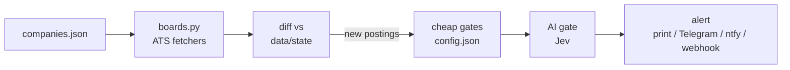

# 🔭 JobRadar

Watch favourite companies' careers pages. Each poll reads the companies' public job boards, finds postings not seen before, screens them
(title, location, wording rules, optionally an AI fit check against your profile) and alerts you on each new match.
Pure standard library Python, no database, no scraping browser.

## ⚙️ How it works



- 🔇 **Baseline run**: the first poll of a company is silent; what is open is marked seen, so only later postings alert.
- 🛡️ **Broken-board guard**: a fetch that errors, comes back empty or under half the last count closes nothing and alerts once on the second failure in a row.
- 💾 **AI cache**: a job description is judged once; the same posting in another location reuses the answer.
- 🩺 **Health report**: `report` digests the run log and flags a silent scheduler, suspect boards, undelivered matches, and technical-looking titles the gate dropped.

📋 Supported boards: Greenhouse, Ashby, Lever, Recruitee, Personio, Workable, SmartRecruiters, Join, Teamtailor, plus location searches on Apple, Google and Microsoft careers.

## 🚀 Setup

```bash
git clone <this repo> && cd JobRadar
cp config.example.json config.json      # your title / location / wording rules, AI gate, alert channel
cp companies.example.json companies.json # your watch list (gitignored, so it stays private)
cp profile.example.md profile.md        # who you are, for the AI gate (skip if the gate is off)
python3 -m jobradar add --name Acme --board greenhouse:acme
python3 -m jobradar run --company acme # silent baseline
python3 -m jobradar run                # every later run alerts on new matches
```

`companies.example.json` is a sample list; `companies.json` is yours and gitignored. To find a company's board token see [docs/finding-boards.md](docs/finding-boards.md).

## 🧰 Commands

| Command | Does |
|---|---|
| `run [--company SLUG] [--dry] [--rescreen]` | poll; `--dry` sends no alerts, `--rescreen` re-judges all open postings after a config change |
| `add --name N --board ats:token [...]` | probe boards, register a company |
| `remove SLUG` / `list` | stop watching / show state |
| `report [--days N]` | health digest, exit 1 when something needs a look |
| `scout FILE` | rank candidate companies (`Name \| careers URL` lines) by roles passing the gates today |

## 🎛️ Configuration

- `config.json`: `titles` include/exclude, `title_drop` regexes, `locations` (include names, remote words, exclude regex), `wording_drop` (JD phrases that rule a role out),
  `skip_urls_file`, `llm`, `notify`. Per company in `companies.json` (copy of `companies.example.json`): `titles_extra`, `titles_exclude`, `no_llm` (skip the AI gate, e.g. retail roles), `enabled`.
- AI gate (`llm.enabled`, on by default): [TypeSafe](https://typesafe.ai) System One (Jev, `TYPESAFE_API_KEY`) answers the typed questions in `prompts/jev_questions.json`
  about each posting against your `profile.md`, as a fit score and probabilities. Thresholds: `fit_min`, `role_match_min`, `language_block_max`, `eligibility_block_max`.
  A job description is judged once; other locations of the same posting reuse the answer. Set `enabled` to `false` for the cheap gates only.
- Alerts (`notify.channel`): `print`, `telegram` (`TELEGRAM_BOT_TOKEN`, `TELEGRAM_CHAT_ID`), `ntfy` (`topic`), `webhook` (`url`). Message text lives in `templates/`.
- Everything personal (`config.json`, `companies.json`, `profile.md`, `skip_urls.txt`, `data/`) is gitignored.

## ⏰ Schedule

`schedule/launchd.plist.example` (macOS) or `schedule/crontab.example`. Run `report --days 1` daily after the poll; it exits 1 when something needs a look.

## 🤖 Claude Code skill

`skills/jobradar/SKILL.md` wraps the CLI as a `/jobradar` skill (status, add, remove, run, report, install). Copy it to `~/.claude/skills/jobradar/`.

## 🧪 Tests

```bash
python3 -m pip install pytest && python3 -m pytest -q
```

Adding an ATS: a `f_<name>(token)` fetcher in `jobradar/boards.py` returning rows `{id, title, url, loc, date, desc}`, a `FETCHERS` entry, and a test.

## 📄 License

MIT, see [LICENSE](LICENSE).

---

Built with ❤️ by Farhad ∙ Istanbul, October 2026.
